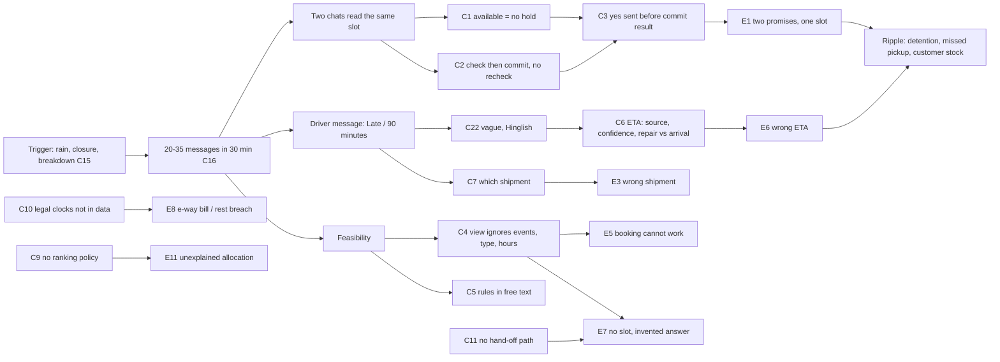

# Cause-Effect Register: SetuHaul Logistics Pvt. Ltd.

**Source:** `01_problem_definition.md` (DRAFT FROM THE BRIEF ONLY, written 25 Nov 2026) and `01_audit_queries.sql`
**Written:** 25 November 2026 | **Step:** FDE step 2, the WHY | **Next:** step 3 (DESIGN)

> **Read this first: what "evidence" means in this document**
> The real SetuHaul snapshot was never supplied. The zip contains a **synthetic stand-in database** (`dummy_setuhaul.db`) that copies the brief's table names, row counts and the Jaipur dock chart. Its planted problems were written to match the brief, so a result there shows that **a query works** and **how a mechanism behaves**. It does **not** show how often something happens at SetuHaul.
>
> So the labels below are used strictly:
> - **Proven (mechanism):** a script ran and showed the behaviour. It holds for any SQLite database with the same rules, so it does not depend on client data. Only used for M1 to M4 in `02_mechanism_demo.py`.
> - **Plausible:** consistent with the brief and with the stand-in data (result marked **PD** = seen on the dummy database). Not yet true for the client until re-run on the real file.
> - **Hypothesis:** no data at all. A test or a client question is named.
> - **No link is "Proven" on client data.** Step 1's own gate is still FAIL for the same reason (no real data audit), so this register carries that open item forward.
>
> Files: `02_evidence_queries.sql` (EV-C numbers match cause IDs), `02_evidence_results_DUMMY.txt`, `02_mechanism_demo.py`, `02_mechanism_demo_output_DUMMY.txt`.

---

## 1. Effects (E-IDs)

Format: ID | Effect | Who is hurt | Impact type | How we would measure it

| ID | Effect | Who is hurt | Impact types | Measure |
|---|---|---|---|---|
| E1 | Two drivers are promised the same slot. One arrives to no dock and waits. | Driver B, carrier, warehouse planner, customer | Operational, **Financial** (detention), Customer | M-3 (target 0): messages saying "yours" vs committed rows |
| E2 | A driver accepts an option that is no longer valid (slot taken, dock down, window closed). | Driver, coordinator | Operational, Customer | M-4: options shown that fail re-check at confirm |
| E3 | The wrong shipment is rebooked, or details of another load are discussed with the driver. | Driver, customer of the other load | Operational, Customer, **Privacy** | I-6: confirm-shipment question asked when driver has 2+ active loads |
| E4 | A repeated message causes a second action or a contradictory reply. | Driver, warehouse | Operational, Customer | I-11: replay the same message twice, count changes |
| E5 | A booking exists that cannot work: wrong dock type, dock broken or in maintenance, slot ends before the truck can arrive. | Driver, warehouse, customer | Operational, **Financial** (detention; possible cargo damage on a reefer load, **Hypothesis**), Customer | Q-06, Q-08, Q-11 counts on the real snapshot |
| E6 | The revised ETA is wrong, so the truck misses the new slot too. | Driver, warehouse, customer | Operational, Financial, Customer | Revised ETA vs actual gate-in (needs real history) |
| E7 | No feasible slot exists and the system invents an answer or goes silent. | Driver, customer (a P1 reefer load in the data) | Operational, Financial, Customer, **Compliance** (no record) | M-5: hand-off record complete |
| E8 | A confirmed plan runs past an e-way bill expiry or breaks a driver rest limit. | Carrier, SetuHaul, driver | **Legal/regulatory**, **Financial** (penalty, detention), **Safety**, Customer | M-12: seeded cases flagged, expect 100% |
| E9 | A safety report ("tyre damaged near Neemrana") is handled as a scheduling request. | Driver | **Safety**, Legal, Reputation | I-5: safety cue always reaches a human |
| E10 | Driver phone numbers or locations get copied into chat logs and operational messages beyond their purpose. | Drivers | **Privacy**, **Legal** (DPDP Act obligations phase in, see step 1 section 9.1), Compliance | I-10: log scan |
| E11 | Scarce slots go by an unwritten rule. A P1 load can lose to a P3 load, and nobody can explain why. | Carriers, customers, coordinators | Customer/reputation, **Commercial** (disputes), Compliance (cannot explain a decision) | M-9: decision vs stated policy |
| E12 | An escalation reaches a coordinator incomplete, or coordinators are swamped, so the driver is asked the same questions again. | Driver, coordinator | Operational, **Compliance** (audit trail) | M-6: fields present per hand-off |
| E13 | Capacity is wasted or reshuffled: slots locked by trucks that cannot reach them, and drivers whose promised slot later changes. | Warehouse, other drivers | Operational (utilisation), Customer | M-8 utilisation; changes to already-told promises |

**Hidden impacts found:** E1, E5, E6 look operational but each carries detention cost (money). E8 looks operational (a late truck) but is a legal and safety matter. E10 looks like a data-hygiene point but is a legal one.

---

## 2. Causal chains (one per effect)

Format: Trigger, Condition, Mechanism, Symptom, Effect, Ripple. Each "why" is tagged with its label and cause ID.

### E1: same slot promised twice
- **Trigger:** rain, a road closure or a loading backlog sends 20 to 35 drivers to chat in 30 minutes (Brief-stated).
- **Why 1:** two conversations ask for the same replacement slot. *Why?* Because few slots are usable for a late truck and all trucks want the nearest one (C16, C9, Plausible PD: 7 delayed standard trucks vs 6 open standard slots in the 11:00 to 14:00 window at Jaipur, EV-C9).
- **Why 2:** both are told "free". *Why?* Because "available" means `slot_status = 'open'`, and nothing records that the slot is being offered to someone (C1, Plausible PD EV-C1; M1 Proven mechanism: both readers saw "free").
- **Why 3:** both say "take it" and both writes proceed. *Why?* Because the check and the write are separate steps (C2).
- **Why 4:** both drivers hear yes. *Why?* Because the "yes" is sent before the write result is known (C3). In M1 the database refused the second write (the partial unique index works), **but both drivers had already been told yes**.
- **Symptom:** one truth in the table, two promises spoken.
- **Effect:** driver B arrives to no dock, waits, may miss the next pickup (the brief's driver says "I also have another pickup tonight").
- **Ripple:** labour waiting, the dock's next truck delayed, customer stock late, coordinator workload, detention cost.
- **Stop:** C2 and C3 are things we can change, so the "why" stops here.

### E2: stale option accepted
- **Trigger:** time passes between "here are options" and "the second one works".
- **Why:** the option shown may have changed (another driver took it, dock breakdown, maintenance event, an earlier appointment cancelled). *Why does acceptance not notice?* Because the system has no record of which option was shown, at which state (C21, Plausible PD EV-C21: no offer table, no offer or version column), and it does not re-check at the moment of commit (C2).
- **Symptom:** driver told "confirmed" for a slot that is gone, or told "sorry" with no new options.
- **Effect:** wasted turn, missed slot, loss of trust.
- **Ripple:** the driver may drive on, trusting a promise that is false.

### E3: wrong shipment
- **Trigger:** a driver with two active loads writes "I'm late".
- **Why:** the chat thread may point to nothing, or to the wrong load. *Why?* Because a thread's shipment link is optional (THR010 has none) and a driver can own two active shipments (C7, Plausible PD EV-C7: 5 of 15 drivers in the stand-in data; DRV006 has two open threads). Short messages ("Late", MSG004) carry no clue (C22, Plausible PD).
- **Effect:** the wrong load is rebooked; details of load B are read out to a conversation about load A.
- **Stop:** the link rule is something we can enforce in the service.

### E4: duplicate message
- **Trigger:** a chat channel repeats or retries a message.
- **Why:** the same text arrives twice, and the second is treated as new. *Why?* Because messages have no external key to detect repeats; there is an `is_duplicate` flag but no sign of how it is set (C8, Plausible PD EV-C8: THR009's "Take the 11 o'clock slot" appears twice with the same timestamp, one flagged).
- **Effect:** a second booking attempt, a second reply, or a second change.

### E5: a booking that cannot work
- **Trigger:** a plan or a rebooking is written without the full feasibility check.
- **Why:** the database only protects two things (one active appointment per slot, one current per shipment). *Proven mechanism (M2):* it accepted a reefer truck into a standard dock, a heavy truck into a reefer dock, a booking in a slot that ended before the ETA, and a booking in a slot marked "maintenance".
- **Why does the data already contain such bookings?** Plausible PD: APT1002 active on a broken dock (Q-06), APT1013, APT1014, APT1015 booked before the latest ETA (Q-11, EV-C1b), and SHP1004 booked on D2 but at D1 (Q-13).
- **Root:** capacity truth is spread over several places that the availability view ignores (C4), and the facility rules are free text (C5).
- **Effect:** truck arrives to an unusable dock, waits, or is refused. **Ripple:** the slot is locked by a booking nobody can use (E13).

### E6: wrong revised ETA
- **Trigger:** the driver writes "around 90 minutes late" or "2 ghante late".
- **Why:** the ETA is taken from the wrong place. *Why?* (a) No field separates repair time from total arrival delay (C6, Plausible PD EV-C6d). (b) Several sources disagree and "latest wins": SHP1013's newest ETA is the warehouse's **low**-confidence one (EV-C6b). (c) One ETA is stored with `Z` instead of `+05:30`; compared as text it looks like 06:15, "before the 11:00 slot", when it is really 11:45 (**M4 Proven mechanism**; SHP1012 on the stand-in data).
- **Effect:** truck rebooked into a slot it still cannot reach.
- **Ripple:** a second rebooking, a second disappointed driver, more load on the same few slots.

### E7: no feasible slot, invented answer
- **Trigger:** a reefer load (P1) is late and the only reefer dock at the facility goes into planned maintenance.
- **Why:** nothing is left. *Plausible PD:* SHP1015 has **0 feasible slots** out of 11 that the view calls free after its ETA (EV-C4b). The "free" evening slot SLT0521 sits inside a maintenance event (EV-C4), and RULE005 says D5 closes at 19:00 while the facility opens until 22:00 (EV-C5, Q-17).
- **Why a wrong answer might be given:** no defined dead-end path (C11): no hand-off table, no owner, no acknowledgement field (Plausible PD EV-C11). Today's only escalation is one line, OM004.
- **Effect:** driver left waiting or given a made-up slot. **Ripple:** a P1 reefer load, possible cargo risk (Hypothesis), customer penalty (terms unknown, C18).

### E8: legal clock breached by a confirmed plan
- **Trigger:** a long delay or a next-day rebooking.
- **Why:** an e-way bill has an expiry that depends on distance (rule from step 1 section 9.1, not confirmed by the owner). *Why would the system miss it?* Because the data has no e-way bill or expiry column and no driver duty-hours column (C10, Plausible PD EV-C10: the column scan found nothing).
- **Effect:** truck stopped with an expired document, penalty, detention, missed delivery; or a driver pushed beyond rest limits. **Label: Hypothesis** for the effect (no data), Plausible for "the data cannot say".
- **Ripple:** contracted drivers may fall under the carrier's HR, not SetuHaul (open question Q5 in step 1).

### E9: safety report treated as scheduling
- **Trigger:** "Tyre damaged near Neemrana" or "tyre issue, 2 ghante late".
- **Why:** the exception type list has `vehicle_damage`, `vehicle_fault`, `traffic` and `unknown` (2 rows), but no field says "is the driver safe, where is the truck, is it on a live road" (C12, Plausible PD EV-C12: MSG006 and MSG009 are tyre reports).
- **Effect:** a stranded driver gets a slot offer instead of a human. **Label: Hypothesis** for harm; the owner (SetuHaul safety lead) must say what counts as a safety cue.

### E10: personal data spread around
- **Trigger:** a driver types their phone number, or a coordinator pastes a number into a message.
- **Why:** phones sit in `drivers` (15) and `facility_contacts` (5), and MSG014 has a number inside free chat text (C13, Plausible PD EV-C13). No consent, purpose or retention field exists in any table (same query).
- **Effect:** data copied into logs and prompts; harder to delete or limit later.
- **Why it matters on a date:** step 1 records that DPDP main duties are scheduled for about May 2027, so this is a build-now, comply-by-then matter (Assumption, owner: legal).

### E11: unexplained allocation
- **Trigger:** three or more trucks want the same few slots.
- **Why:** nothing says how to rank them. Priority codes P1/P2/P3 exist (3/6/12 trucks); the only rule is RULE006, "Critical loads may pre-empt standard loads" and only at B1 in Bhiwandi (C9, Plausible PD EV-C9). The brief itself says the policy is **not supplied**.
- **Effect:** first-come-first-served by accident of timing; a carrier cannot be told why it lost. **Owner:** SetuHaul operations head decides the rule; code only applies it.

### E12: incomplete hand-off, overloaded coordinators
- **Trigger:** a spike produces several no-slot or safety cases at once.
- **Why:** five coordinators per shift (Brief-stated) cover everything that cannot be automated, and the current escalation record has no structured fields (C11, C16).
- **Effect:** the coordinator re-asks the driver, delays, or acts without the history. Plausible; no response-time data (U-4 in step 1).

### E13: wasted or reshuffled capacity
- **Trigger:** pending or confirmed bookings stay in place after the truck's ETA has moved.
- **Why:** nothing expires or releases them (C1). Plausible PD: SHP1013 and SHP1014 hold **pending** slots they cannot reach (their latest ETAs fall after the slot ends); the unique index counts a pending booking as active (EV-C1b).
- **Effect:** the slot looks taken but nobody will use it; other trucks are refused. Later release changes a promise already told to someone (ripple).

---

## 3. Fishbone sweep (causes by category)

Every High lens from step 1's context profile (industry, location, financial, legal, privacy, safety) is swept. One line per category, even where the answer is "not relevant".

| Category | Causes found (C-IDs) |
|---|---|
| **Input / people** | C22 messages are short, vague or Hinglish ("Late", "2 ghante late"), and do not say whether a delay is repair time or arrival delay. C7 one driver, two loads. C8 repeated sends. Drivers change their minds ("the second one works, but I need to leave by 9"): handled by C21. |
| **Data** | C6 mixed time formats, "latest wins", no repair-vs-arrival field. C14 systems disagree (SHP1004 booked D2, docked D1, status in_transit; APT1002 active on a broken dock). C20 foreign keys off by default; timestamps are free text. |
| **Process / policy** | C9 no allocation policy. C21 an offer has no identity. C1 "available" has no meaning while someone is deciding. |
| **Capacity / constraints** | C4 view ignores dock events, dock type, hours. C5 rules in free text, RULE005 clashes with hours, RULE003 15-minute buffer vs 0-gap bookings (7 pairs, EV-C5). C17 unload duration unknown, slots fixed at 60 minutes. C16 few usable replacement slots. |
| **Concurrency / timing** | C1 no hold, no expiry. C2 check and commit are separate. C21 no version on an offered option. |
| **Integration** | C3 promise sent regardless of commit result. C19 a rebooking is two writes (cancel old, create new); old row ends as `cancelled`, not the `replaced` status the index allows (EV-C19). C14 five systems, no winner. |
| **Environment** | C15 rain, road closure, breakdown, loading backlog. Not controllable; only planned for. |
| **Regulatory / legal** | C10 e-way bill expiry and driver rest limits not in the data. C13 DPDP obligations for phone, chat text, location. |
| **Commercial / contractual** | C18 detention charges, penalty terms, who pays: unknown. C9 priority tiers promised to some customers: unknown. |
| **Location / infrastructure** | Hinglish and place names inside messages (C22). City truck-entry windows and network dead zones: **not relevant to the data we hold, but not checked** (step 1 question Q2 stays open). |
| **Organisation / decision rights** | C11 no owner or acknowledgement for hand-offs. C9 policy owner unnamed. C16 five coordinators per shift. C14 nobody declared which system wins (U-1). |

### Cause list (C-IDs used above)

| ID | Cause | Fishbone category |
|---|---|---|
| C1 | "Available" means slot_status is open. No hold state, no expiry, so "offered" is not "reserved". | Concurrency / Process |
| C2 | Feasibility check and commit are separate steps, with no re-check at commit. The unique index guards one slot row, not one dock-time. | Concurrency |
| C3 | The reply to the driver is sent without waiting for the commit result. | Integration |
| C4 | Capacity truth lives in several places (slot status, dock events, dock status, hours, dock type). The availability view reads only one. | Capacity / Data |
| C5 | Facility rules are free text and clash with each other and with the slot grid. | Capacity / Policy |
| C6 | No single resolved ETA with a source and confidence. "Latest wins", mixed time-zone formats, repair time vs arrival delay not separated. | Data / Input |
| C7 | A conversation is not guaranteed to be tied to one shipment. | Input / Data |
| C8 | Inbound messages carry no external key to detect repeats. | Integration / Input |
| C9 | No written allocation policy and no named owner. | Process / Organisation |
| C10 | Legal clocks (e-way bill expiry, driver rest) are not in the data. | Regulatory |
| C11 | No defined dead-end path: no structured hand-off, owner, acknowledgement or deadline. | Organisation |
| C12 | A safety signal is buried in free text, with no flag. | Input / Safety |
| C13 | Personal data is written wherever convenient; no purpose or retention fields. | Regulatory / Privacy |
| C14 | Five systems, and no declared winner when they disagree. | Data / Organisation |
| C15 | Rain, road closure, breakdown, loading backlog. | Environment |
| C16 | Messages bunch in a spike while usable replacement slots and coordinators stay few. | Capacity / Organisation |
| C17 | Unload duration is not in the data; slots are fixed at 60 minutes. | Capacity |
| C18 | Detention, penalty and SLA terms are unknown. | Commercial |
| C19 | A rebooking is more than one write; a failure in the middle leaves a half-done state. | Integration |
| C20 | Foreign keys are off on a default connection; timestamps are plain text. | Data |
| C21 | An offered option has no identity or version, so acceptance cannot be checked against what was shown. | Process / Concurrency |
| C22 | Driver text is short, vague or mixed-language. | Input / Location |

---

## 4. Evidence table

Label legend: **Proven (mech.)** = demonstration script; **Plausible PD** = query run on the stand-in database; **Hypothesis** = no data.

| C-ID | Link | Label | Query or test and result |
|---|---|---|---|
| C1 | "Available" ignores any hold; no hold, expiry or offer column | Plausible PD | EV-C1: statuses seen are open, booked, blocked, maintenance, breakdown (slots) and cancelled, completed, confirmed, in_progress, no_show, pending_confirmation (appointments). No hold; column scan for hold/expiry/ttl/reserved: 0 rows. |
| C1 | Two readers both see "free" | **Proven (mech.)** | M1: A reads free, B reads free. |
| C1 / E13 | Pending bookings lock slots trucks cannot reach | Plausible PD | EV-C1b: APT1013, APT1014 (pending) and APT1015 (confirmed): latest ETA after slot end. |
| C2 | Second write is stopped by the table, after the promise | **Proven (mech.)** | M1: A write OK, B write rejected (`UNIQUE constraint failed: appointments.slot_id`); 1 active row; both drivers already told yes. |
| C2 | The index does not stop overlapping dock-times | Plausible PD | Q-10 returned 0 overlaps in the stand-in data; whether the real slot grid can overlap is **Hypothesis** (ask the dock scheduler owner). |
| C3 | Promise is decoupled from commit | Hypothesis | Applies to the service we will build. The brief's own diagram shows promise-then-write. Test in step 5: force a write failure and read what the driver hears. |
| C4 | View marks a slot free when a dock event covers it | Plausible PD | EV-C4: SLT0521 (D5, 21:00 to 22:00) free in the view; planned maintenance 19:00 to 22:00. |
| C4 | The database accepts infeasible bookings | **Proven (mech.)** | M2: reefer into standard dock ACCEPTED; heavy into reefer dock ACCEPTED; slot that ended before ETA ACCEPTED; slot marked 'maintenance' ACCEPTED. |
| C4 | Free-looking choices overstate real choices | Plausible PD | EV-C4b (view-free after ETA vs feasible by code): SHP1015 reefer 11 to **0**; SHP1010 reefer 54 to 6; SHP1011 heavy 54 to 10; standard trucks about 50 to 54 to 35 to 38. Upper bound only: ignores unload time, buffer and other offers. |
| C5 | Rules clash with grid | Plausible PD | EV-C5: 7 pairs of booked neighbours on D1, D2, D4 with a 0-minute gap against RULE003 (15 minutes). The slot may already include the buffer: **ask the warehouse planner**. RULE005: D5 closes 19:00 vs facility open to 22:00 (Q-17). Rules are text of 30 to 77 characters. |
| C6 | ETA stored in two time formats | **Proven (mech.)** | M4: `06:15:00Z` compares as earlier than 11:00+05:30 as text, but is later in real time. Stand-in row: ETA007 (SHP1012). |
| C6 | "Latest wins" can pick the weakest source | Plausible PD | EV-C6b: SHP1013 history plan(high) < driver(medium) < warehouse(low); the newest is the low one. |
| C6 | No repair-vs-arrival field | Plausible PD | EV-C6d: no column with repair, delay or minutes. |
| C6 | View returns two rows for a tie | Plausible PD (not seen) | EV-C6c: 0 rows. Risk remains if two updates share a timestamp. |
| C7 | Driver with two active loads | Plausible PD | EV-C7: DRV002, 003, 004, 006, 010 each have 2 active shipments; THR010 has no shipment; DRV006 has 2 open threads. |
| C8 | Repeated messages, no external key | Plausible PD | EV-C8: THR009 "Take the 11 o'clock slot" twice at 10:05, one flagged; `chat_messages` columns: id, thread, sender, text, timestamp, is_duplicate (no channel message id). |
| C9 | Demand exceeds supply nearby | Plausible PD | EV-C9: 7 delayed standard trucks at Jaipur vs 6 open standard slots between 11:00 and 14:00. Shape only (the stand-in was built to match the brief). |
| C9 | No ranking rule | Plausible PD | EV-C9: priorities P1 3 / P2 6 / P3 12; only RULE006 (Bhiwandi). Brief: policy "not supplied". |
| C10 | No legal-clock data | Plausible PD | EV-C10: column scan for eway/valid/document and duty/rest/shift/hours: 0 rows. Effect itself: **Hypothesis**, owner SetuHaul compliance. |
| C11 | Hand-off record has no structure | Plausible PD | EV-C11: `operational_messages` has 6 columns (no owner, status, acknowledgement); 1 escalation, OM004, "No compatible reefer slot found. Escalated to coordinator."; no hand-off-like table. |
| C12 | Safety cue in free text only | Plausible PD | EV-C12: tyre messages MSG006, MSG009; exception types include vehicle_damage 2, vehicle_fault 1 (escalated), unknown 2; no "driver safe?" field. Harm itself: **Hypothesis**. |
| C13 | Phone in free text; no purpose fields | Plausible PD | EV-C13: MSG014 has a 10-digit number; phones in drivers (15) and facility_contacts (5); no consent/purpose/retention columns. |
| C14 | Systems disagree | Plausible PD | EV-C14: SHP1004 status in_transit, docked at D1, booked D2; Q-06 APT1002 active on a broken dock. Which source wins: Hypothesis (U-1). |
| C15 | External triggers | Hypothesis | Planned for, not tested. |
| C16 | Messages bunch | Plausible PD + Brief-stated | EV-C16: driver messages per half hour in the stand-in data 1, 3, 4, 5. Brief: 20 to 35 in 30 minutes in a spike. |
| C17 | No unload duration; fixed 60-minute slots | Plausible PD | EV-C10/17: no duration/unload column; slot length is 60 minutes for every slot. Effect (detention from overrun): Hypothesis (U-2). |
| C18 | Money terms unknown | Hypothesis | EV-C18 column scan: 0 rows. Ask finance (Q7). |
| C19 | Rebooking leaves a half state | Plausible PD | EV-C19: APT1008 ends `cancelled` with `is_current` 0, APT1008B confirmed; vocabulary has `replaced` but it is not used. No test yet of a failure between the two writes: **Hypothesis**, test in step 5. |
| C20 | Foreign keys off; text timestamps | **Proven (mech.)** | M3: `PRAGMA foreign_keys = 0`; an appointment pointing at a non-existent shipment and slot was ACCEPTED. Whether the real service connection sets the pragma: unknown. |
| C21 | An offer is not a recorded thing | Plausible PD | EV-C21: no offer/option/proposal table; no offer or version column in chat or appointment tables. |
| C22 | Short, vague, mixed-language messages | Plausible PD | EV-C22: MSG004 "Late" (4 characters), MSG006 Hinglish, MSG014 Hinglish, MSG001 Hinglish. |

---

## 5. Failure-mode table (light FMEA)

Severity is scored on the **worst** impact type, not just the operational one. Likelihood is **my estimate** and must be calibrated against real logs.

| ID | Failure mode | Cause IDs | Effect | Sev 1-5 | Lik 1-5 | Detectable? | Priority (S x L) |
|---|---|---|---|---|---|---|---|
| F1 | **Race:** two actors chase the same slot | C1, C2, C3, C16 | E1 | 4 | 4 | Partly: table rejects the 2nd write, but the promise is already out | **16** |
| F2 | **Stale read:** option shown, world changes, option accepted | C1, C21, C4, C14 | E2 | 4 | 4 | Yes if re-checked at confirm | **16** |
| F3 | **Duplicate or retry** of the same message | C8 | E4 | 3 | 4 | Yes if keyed | 12 |
| F4 | **Partial failure:** old booking cancelled, new one not created (or DB saved, message not sent) | C3, C19 | E1, E2, E13 | 4 | 3 | Hard: nothing flags it | 12 |
| F5 | **Conflict:** sources disagree about ETA, status or dock | C6, C14 | E5, E6 | 4 | 4 | Yes, with a cross-check | **16** |
| F6 | **Dead end:** no valid option | C4, C9, C11, C17 | E7 | 5 | 3 | Yes, count of feasible = 0 | **15** |
| F7 | **External rule broken** by a valid-looking confirmation (e-way bill, driver rest) | C10, C18 | E8 | 5 | 3 | **No**: data absent | **15** |
| F8 | **Personal data** used beyond purpose, kept too long or exposed | C13 | E10 | 3 (rising as obligations start about May 2027) | 5 | Yes, log scan | 15 |
| F9 | **Safety report** handled as scheduling | C12, C22 | E9 | 5 | 3 | Hard: depends on language | **15** |
| F10 | **Infeasible booking** accepted (dock type, broken dock, before ETA) | C4, C5, C17 | E5 | 4 | 4 | Yes, with a check | **16** |
| F11 | **Wrong shipment** acted on | C7, C22 | E3 | 4 | 4 | Yes, with a confirm question | **16** |
| F12 | **Data integrity:** orphan rows, text-time comparison | C6, C20 | E5, E6 | 3 | 3 | Yes | 9 |
| F13 | **Unfair or unexplained ranking** | C9 | E11 | 3 | 4 | Yes if policy is written | 12 |
| F14 | **Hand-off incomplete or too slow** | C11, C16 | E12 | 4 | 3 | Yes, field check | 12 |

All eight standard failure modes from the skill are covered (F1 to F8). F9 to F14 come from this client's effects.

---

## 6. Controllability

| Tag | Causes |
|---|---|
| **Controllable** (we can remove it) | C1, C2, C3, C4, C6, C7, C8, C11, C12 (detect and hand off), C13, C19, C20, C21, C22 (ask before acting) |
| **Influenceable** (we can reduce it) | C5 (needs the planner to clarify rules), C9 (needs the policy owner), C14 (needs a "who wins" decision), C16 (queue and escalation design, but the volume is not ours), C17 (needs duration data) |
| **External** (detect and respond only) | C15 (rain, closures, breakdowns), the legal rules behind C10 (we can only check them, not change them) |
| **Unknown owner** | C10 data gap (who holds e-way bill data), C18 (finance) |

---

## 7. Required properties and owning layer (handoff to step 3)

A **property** is what any fix must guarantee. It is not the fix. No technology is chosen here.

| C-ID | Required property | Owning layer |
|---|---|---|
| C1 | "Shown", "held", "requested", "confirmed" are distinct states, and a held slot is visible to every other reader. A hold has an owner and an end time. | Database (state) + Deterministic code (rules) |
| C2 | Commit is **atomic** and **re-checks feasibility** at the moment of commitment. One dock-time can never have two active bookings, not only one slot row. | Database (transaction, constraint) + Deterministic code |
| C3 | The driver is never told "yours" unless the system of record has the commit. A failed commit produces a different, truthful message. | Tool / API + Deterministic code (the LLM only phrases what code returns) |
| C4 | One feasibility check combines dock type, dock status and events, facility hours, rules, ETA and duration, and is the **only** way an option is produced. | Deterministic code |
| C5 | Each facility rule is a machine-readable rule with an owner, and clashes are reported instead of ignored. | Policy owner (warehouse planner) then Deterministic code |
| C6 | Every ETA carries a **source and a confidence**; times are stored in one zone and compared as times; repair time and arrival delay are separate facts; the driver is told how sure the system is. | Deterministic code + Conversation (asks the driver) |
| C7 | An action is never taken until one shipment is confirmed. A driver with 2+ active loads is asked which one. | Conversation (asks) + Deterministic code (enforces) |
| C8 | Requests are **idempotent**: the same message twice has the same effect as once. | Tool / API + Database |
| C9 | Ranking follows a **written, explainable policy**. A refusal can be explained in plain words. | **Policy owner** (operations head), enforced by Deterministic code |
| C10 | Before any confirmation, a document-validity and driver-hours rule is checked **by code**; if it might be breached, the case goes to a human instead. | **Policy owner** (compliance) then Deterministic code, then Human |
| C11 | A no-slot case produces a **complete hand-off record** (who, what, state, options shown, why, deadline) and an acknowledgement. | Deterministic code + Human |
| C12 | A safety cue always reaches a human, and the system does not offer slots first. | Human (decides what counts) + Conversation (detects) |
| C13 | Personal data is collected only for its purpose and kept only as long as allowed. Phone numbers are not copied into logs or prompts. | **Policy owner** (legal) then Tool / API + Database |
| C14 | One declared source of truth per fact, and a visible alert when sources disagree. | **Policy owner** (operations head) + Deterministic code |
| C16 | Under a spike, requests are queued and answered in a stated order; unresolved ones reach a human with the record intact. | Deterministic code + Human |
| C17 | Unload duration is a data input per load type, not a guess. | Policy owner (warehouse planner) |
| C19 | Cancel-old and create-new succeed or fail **together**. | Database (transaction) |
| C20 | Constraints are enforced on every connection; time values are valid and carry an offset. | Database |
| C21 | An accepted option is tied to **the exact option and state that was shown**, and is rejected if either changed. | Tool / API + Database |
| C22 | The agent asks only for facts the backend does not hold, in the driver's language, and states back what it understood. | Conversation (LLM) |

Overall rule that follows from the table: **the LLM handles messy language. Code and the database handle capacity, feasibility and commitment. A person handles safety, money and contradictions.**

---

## 8. Priority list (design agenda for step 3)

Score = Impact (1-5) x Frequency (1-5) x Evidence strength (1 Hypothesis, 2 Plausible, 3 Proven mechanism). Frequencies are estimates, not measurements.

| Rank | Cause(s) | I | F | Ev | Score | Why it is on the agenda |
|---|---|---|---|---|---|---|
| 1 | **C1 + C2 + C3** "promise is not a commit" | 5 | 4 | 3 / 3 / 2 | 60 / 60 / 40 | The brief's central failure. Mechanism shown (M1). |
| 2 | **C4** feasibility spread across places | 4 | 4 | 3 | 48 | M2 shows the database accepts infeasible bookings. |
| 3 | **C6** ETA without source, confidence or one time format | 4 | 4 | 3 | 48 | M4 shows a wrong comparison. Feeds every later decision. |
| 4 | **C9** no allocation policy | 4 | 4 | 2 | 32 | Required for "several requests, one slot set". Policy owner needed. |
| 5 | **C14** systems disagree, no winner | 4 | 4 | 2 | 32 | Needs a decision from the operations head (U-1). |
| 6 | **C7 + C22** right shipment, ask before tool | 4 | 3 to 5 | 2 | 24 to 30 | The conversation layer's main job. |
| 7 | **C11** dead end and hand-off | 5 | 3 | 2 | 30 | Needed for "ends in one escalation". |
| 8 | **C13** personal data | 3 | 5 | 2 | 30 | Cheap to design in now, costly later. |

**Must-resolve unknowns (Severity 5 but no data, so the score understates them):** C10 (e-way bill and driver hours), C12 (what counts as a safety cue), C18 (money terms). They go to step 3 as **constraints that route to a person**, not as designs to guess. Also carried: C8 (duplicates, score 24), C21 (offer identity, 16, folds into rank 1), C5 and C17 (rules and duration, need the planner).

---

## 9. Diagram

---

## 10. Open questions and tests still to run

**Blocking (needed before anything is "Proven" on client data)**
1. Obtain the real SQLite snapshot and run `python3 run_audit.py REAL.db 01_audit_queries.sql` and then `... 02_evidence_queries.sql`. Re-label every "Plausible PD" row with the real result (Proven, or downgraded). Column names in my queries were inferred from the brief's ER diagram, so check `.schema` first.
2. Replace the stand-in's results. Several "problems" in it were planted, so a hit there says nothing about how common they are.

**Client questions (owner)**
| # | Question | Owner |
|---|---|---|
| 1 | Does one slot row always mean one dock-time, or can the grid overlap (C2)? | Dock scheduler owner |
| 2 | Does the 60-minute slot already include the 15-minute cleaning buffer (RULE003, C5)? Is RULE005 right that D5 closes at 19:00? | Warehouse planner |
| 3 | Which system wins when plan, scheduler and gate check-in disagree (C14)? | Operations head |
| 4 | Written priority policy, and who owns it (C9)? | Operations head |
| 5 | How long should an offered slot be held (C1)? | Warehouse planner |
| 6 | Where is the e-way bill number and expiry kept, and who extends it (C10)? | Compliance |
| 7 | What counts as a safety cue, and who answers a safety report (C12)? | Operations head + safety lead |
| 8 | Detention charges, penalty terms, who pays (C18)? | Finance |
| 9 | How is the `is_duplicate` flag set (C8)? Is there a channel message ID? | SetuHaul technology |
| 10 | Purpose and retention for chat text and phone numbers (C13)? | Legal / data protection lead |

**Tests to write in step 5 (BREAK)**
- Force a failure between "commit" and "send reply" and read what the driver hears (F4, C3).
- Cancel-old then fail before create-new (F4, C19).
- Replay THR009's duplicate message (F3, C8).
- Offer an option, block the slot, then accept (F2, C21).
- Seed SHP1015: expect escalation with a complete record (F6).
- Seed an e-way bill expiry and a rest-limit case once the data exists (F7).

---

## Quality gate (before handing to step 3)

| Check | Status |
|---|---|
| Every effect traces back to at least one root cause | Pass (E1 to E13, section 2) |
| Symptoms are not listed as causes | Pass |
| Every link labelled Proven, Plausible or Hypothesis, with evidence or a test | Pass (section 4) |
| All standard failure modes covered | Pass (F1 to F8, plus F9 to F14) |
| Each priority cause has a required property and an owning layer | Pass (section 7) |
| No technology or code chosen | Pass. The demo script only reproduces the failures. |
| Every effect tagged with impact types, including hidden financial, legal or compliance impacts | Pass |
| Every High lens swept, and every fishbone category has a line | Pass |
| Rules owned by legal, compliance or the business assigned to a Policy owner | Pass (C5, C9, C10, C13, C14, C17) |
| **Evidence run on the real snapshot** | **FAIL, inherited from step 1.** Nothing is Proven on client data. Step 3 can start from the agenda, but its design choices rest on mechanisms, not on SetuHaul measurements. |
